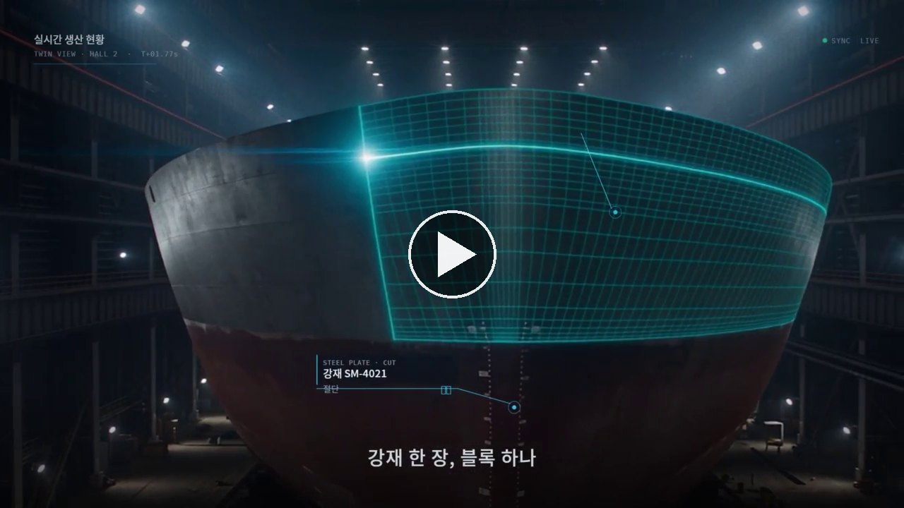
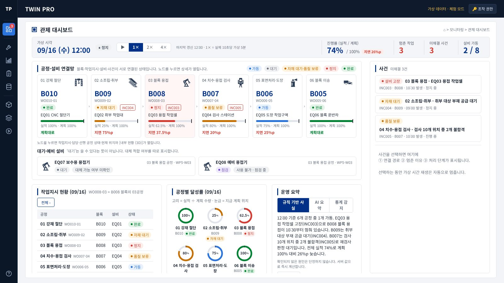
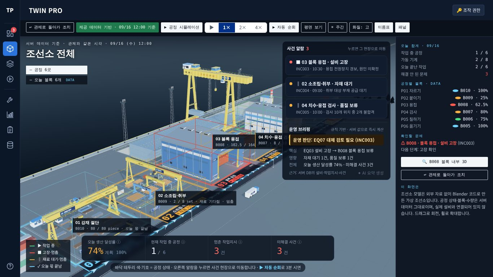
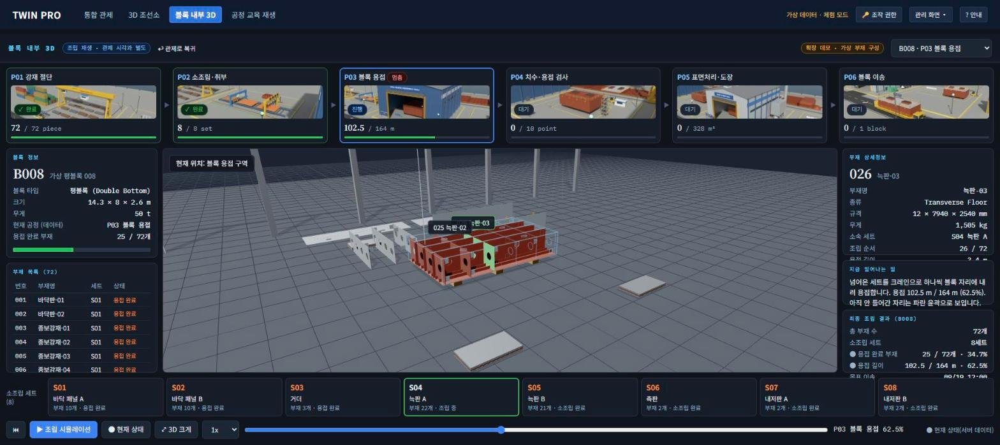
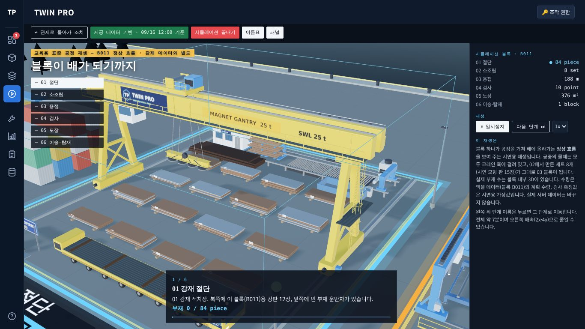

# TWIN PRO — 조선 블록 공정 디지털트윈 운영 모니터링

<!-- TOP:START -->
조선 블록 제작 공정(강재 절단 → 소조립·취부 → 블록 용접 → 치수·용접 검사 → 표면처리·도장 → 블록 이송)의 운영 상태를 한 화면에서 보고, 설비 고장·자재 대기 같은 문제를 처리 순서대로 해결해 보는 시연 시스템입니다. 2026 울산 청년 AX 리더십 프로젝트에서 팀 TWIN PRO의 과제(디지털트윈 기반 제조 운영 모니터링 플랫폼)로 만들었습니다.

- 바로 보기: https://develop-korea-tech.github.io/twinpro-demo/
- 구성: 화면 파일 `index.html` 하나 + Supabase(Postgres) 서버 + 3D 조선소 모델 `twinpro_shipyard.glb`
- 기술: JavaScript, Supabase(Postgres · RPC · Realtime · Edge Function), Three.js 0.160(3D), Blender Python(3D 모델 제작)
- 데이터: 과제에서 제공한 조선 블록 제작 가상 데이터(엑셀 15개 시트)

### 소개 영상

| 인트로 영상 (2026-10-18, 1분) | 1차 인트로 영상 (2026-10-06, 1분 20초) |
|---|---|
| [](https://develop-korea-tech.github.io/twinpro-demo/media/twinpro-intro-2026-10-18.mp4) | [](https://develop-korea-tech.github.io/twinpro-demo/media/twinpro-intro-2026-10-06.mp4) |
| 1920×1080. 현장 문제(흩어진 정보, 늦은 판단)에서 TWIN PRO 화면으로 이어지는 구성 | 1280×720. 노래 「트윈 뷰」에 맞춘 영상, 당시 팀 가제(TWIN VIEW)가 들어가 있음 |

- 이미지를 누르면 브라우저에서 영상이 재생됩니다. 영상 파일은 `media/` 폴더에 있습니다.
- 실사 장면은 AI 영상 생성 도구로 만들었습니다.

### 화면

| 통합 관제 | 3D 조선소 |
|---|---|
|  |  |
| 왼쪽 아이콘 사이드바 + 공정 6곳의 블록 · 작업지시 · 설비 · 사건 연결 상태, 진행률 · 멈춘 작업 · 미해결 사건 · 설비 가동 지표, 사건 목록과 운영 요약 | 관제 톤 3D 조선소: 바닥 상태 표기 · 하단 KPI · 사건 알람과 운영 브리핑, 평면 보기 · 사건 현장 · 자동 순회 |
| **블록 내부 3D** | **공정 교육 재생** |
|  |  |
| 블록 하나(예: B008)의 부재 72개 · 소조립 세트 8개 조립 상태와 공정별 진행, 조립 시뮬레이션 | 블록 하나가 01 절단부터 06 이송 · 탑재까지 거쳐 배에 올라가는 정상 흐름 재생(서버 데이터는 바꾸지 않음) |
<!-- TOP:END -->

---

## 시연 서버 정보

조선 블록 제작 운영 모니터링 시연 시스템입니다. 관제·관리 화면 5개(01H 확정안: 관제 대시보드 · 설비 상태 · 생산 현황 · 작업 관리 · 기준정보)와 3D 확장 화면(3D 조선소 · 블록 내부 3D · 공정 교육 재생), Supabase(Postgres) 서버 함수로 구성되어 있으며, 받은 엑셀(`02 가상데이터.xlsx`) 15개 시트를 그대로 DB에 올려 사용합니다.

- 화면 주소: **https://develop-korea-tech.github.io/twinpro-demo/** (GitHub Pages, 저장소 develop-korea-tech/twinpro-demo)
- 화면 파일: `index.html` 한 파일(2026-10-24 빌드, 이후 사이드바 수정 포함). 전체 소스 패키지에서는 같은 빌드 결과물의 이름이 `twinpro.html`입니다. 이 문서에서는 화면 파일을 모두 `index.html`로 적습니다.
- 서버: Supabase 프로젝트 `twinpro-demo`(서울 리전)
  - 주소: `https://rrgvqgphhwzkeuvdwndu.supabase.co` (`index.html`에 이미 들어 있습니다)
  - 시연 코드: 팀 단톡방에서 따로 공유합니다.
  - 현재 화면이 쓰는 서버 기능: `tp_` 테이블 24개 읽기, 서버 함수(RPC) 14개, Edge Function 1개(AI 요약 `tp-ai-summary`)
  - 이 저장소의 `supabase_setup.sql`에 들어 있는 것: 테이블 20개(화면이 읽는 18개 + 내부용 `tp_seed` · `tp_config`), 화면에서 호출을 허용한 RPC 13개(현재 화면은 이 중 8개를 부름), 뷰 2개. 나머지(확장 테이블 6개, 확장 RPC 6개, Edge Function)는 전체 소스 패키지의 확장 SQL과 함수 코드에 있습니다(2-1, 4장 '서버 규칙'). 시연 서버에 실제로 설치된 전체 개수는 이 저장소의 파일로는 확인할 수 없습니다.
- 기준시점: 2026-09-16(수) 12:00. 가상 시각은 화면의 재생 버튼(▶)으로 진행되며(1× = 실제 10초당 가상 5분), 16:00에 멈춥니다.

---

## 1. 폴더 구성

### 이 저장소의 파일

| 파일 | 크기 | 설명 |
|---|---|---|
| `index.html` | 약 1.1MB | 시연 화면(2026-10-24 빌드, 3D 관제 연출 추가). 화면 코드(계산 · 서버 연결 · 화면 · 3D), 그림 자료(사건 설명도 3개, 공정 썸네일 6장, 아이콘), 서버 주소와 공개(anon) 키가 한 파일에 들어 있습니다. 데이터 행은 들어 있지 않고, 열 때마다 서버에서 읽습니다. 전체 소스 패키지의 `twinpro.html`과 같은 빌드 결과물입니다. |
| `twinpro_shipyard.glb` | 약 7.5MB | 3D 조선소 모델(Blender에서 내보낸 glTF). `index.html`과 **같은 폴더**에 있어야 3D 조선소 · 공정 교육 재생 화면이 열립니다. |
| `supabase_setup.sql` | 약 175KB | Supabase 기본 설치 SQL. 테이블 20개, 규칙 함수(R1~R7 등), 뷰 2개, 엑셀 원본 15개 시트, 보안(RLS · 권한) · 실시간 설정이 들어 있습니다. 현재 화면의 확장 기능용 테이블 · 함수는 **들어 있지 않습니다**(2-1). |
| `media/twinpro-intro-2026-10-18.mp4` · `.jpg` | 약 26.8MB · 53KB | 인트로 영상(1920×1080, 1분)과 포스터 이미지 |
| `media/twinpro-intro-2026-10-06.mp4` · `.jpg` | 약 19.4MB · 89KB | 1차 인트로 영상(1280×720, 1분 20초)과 포스터 이미지 |
| `docs/screen-dashboard.jpg` | 약 133KB | 화면 캡처: 통합 관제 |
| `docs/screen-3d-shipyard.jpg` | 약 220KB | 화면 캡처: 3D 조선소(관제 톤, 2026-10-24) |
| `docs/scenario_3min.md` | 약 5KB | 3D 관제 3분 시연 대본(장면별 말할 문장 · 화면 조작 · 확인할 값 · 대체 경로 · 예상 질문) |
| `docs/screen-block-3d.jpg` | 약 159KB | 화면 캡처: 블록 내부 3D |
| `docs/screen-process-replay.jpg` | 약 141KB | 화면 캡처: 공정 교육 재생 |
| `README.md` | — | 이 문서 |

### 전체 소스 패키지 (이 저장소에는 올리지 않음)

아래 파일은 팀의 전체 소스 패키지에만 있고 **이 저장소에는 없습니다**. 목록은 이전 문서 기준이며, 이 저장소에서는 내용을 확인할 수 없습니다. 6장의 명령과 7장의 결과 파일도 이 패키지 기준입니다.

| 파일 | 설명 |
|---|---|
| `twinpro.html` | 빌드 결과물(시연 화면). 이 저장소에는 `index.html`이라는 이름으로 올렸습니다. |
| `twin3d/` | 3D 모델을 만드는 Blender 스크립트(`scene.py`, `lib.py`), 텍스처 생성(`make_tex.py`), 내보내기(`export.py`), 발표용 렌더(`render.py`) |
| `renders/` | 발표용 고품질 렌더 이미지(조감도·공정 클로즈업) |
| `supabase_step2.sql` | 현재 프로젝트 설치 때 쓴 2단계 SQL(초기화 함수·원본 적재·보안). 다시 실행할 필요는 없습니다. |
| `supabase_step3.sql` | 3단계 확장 SQL(AI 운영 요약·가상 설비 신호·실적 가져오기). 기존 데이터는 바꾸지 않고 추가만 합니다. |
| `supabase/functions/tp-ai-summary/index.ts` | AI 운영 요약 서버 코드(Supabase Edge Function). Claude API를 부릅니다. |
| `docs/AI_운영요약_프롬프트.md` | AI 운영 요약 프롬프트·입력·출력 규격(산출물). 이 저장소의 `docs/`에는 화면 캡처만 있습니다. |
| `src/` | 화면 소스. `model.js`(계산), `api.js`(서버 연결), `ui.js`(화면), `t3d.js`(3D 확장 데모), `style.css`. 현재 빌드의 코드 주석에는 `sim3d.js`(공정 교육 재생)와 `figures/<사건 ID>/build.mjs`(사건 설명도)도 나옵니다. |
| `sql/` | 서버 소스. `01_schema.sql`, `02_functions.sql`, `03_seed.sql`(엑셀 원본), `04_security.sql`, `05_extend.sql`(확장 기능), `06_extend_security.sql`, `07_sim_lock.sql`·`08_sim_lock_security.sql`(재생 잠금), `09_trial.sql`(체험 모드), `10_trial_play.sql`(코드 없이 내 화면에서만 시간 진행). 현재 화면이 쓰는 사건 처리 단계(`tp_incident_step`) · 대체 적합성(`tp_equipment_fit`)용 SQL은 이 목록에 없으니 패키지에서 파일을 확인합니다. |
| `extract.py`, `sql/make_seed.py`, `build.py` | 엑셀 → JSON → SQL, 소스 → 완성 HTML을 만드는 스크립트 |
| `e2e.js`, `lib_local.js` | 자동 테스트. 같은 SQL을 로컬 Postgres에 올려 실제 화면을 클릭으로 검증합니다. |

이 밖에 6·7장에 나오는 `02 가상데이터.xlsx`(받은 엑셀), `config.json`(빌드 설정), `dist/`(빌드 결과), `e2e_result.json` · `supabase_live_result.txt`(테스트 결과)도 패키지 쪽 파일입니다.

---

## 2. 실행 방법 (이미 설치된 서버에 붙을 때)

1. **화면을 엽니다.**
   - 가장 쉬운 방법은 크롬에서 https://develop-korea-tech.github.io/twinpro-demo/ 를 여는 것입니다. 인터넷 연결이 필요합니다(서버 연결 라이브러리 supabase-js, 3D 라이브러리 Three.js, 글꼴을 인터넷에서 불러옵니다).
   - `index.html`에는 서버 주소와 공개(anon) 키가 들어 있어 연결 설정 없이 바로 붙습니다. 다른 Supabase에 붙이는 방법은 5장에 있습니다.
   - 내 PC에서 열 때는 저장소를 내려받아 `index.html`을 더블클릭해도 같은 서버에 붙습니다. 다만 파일로 직접 열면(주소가 `file://`로 시작) 브라우저 보안 규칙 때문에 3D 모델 파일을 읽지 못해, 3D 조선소와 공정 교육 재생에 "3D 모델을 불러오지 못했습니다"가 나옵니다(블록 내부 3D는 모델 파일을 쓰지 않아 열립니다). 3D까지 보려면 간단한 웹 서버로 엽니다.
     1. `index.html`이 있는 폴더에서 터미널(Windows는 명령 프롬프트)을 엽니다.
     2. `python -m http.server 8000`을 입력합니다(Python 3 필요. 이 창은 닫지 않고 둡니다).
     3. 크롬 주소창에 `http://localhost:8000/`을 입력합니다.
2. **첫 안내 카드를 닫습니다.** 처음 방문해 통합 관제로 열면 「TWIN PRO · 조선 블록 생산 관제 시연」 카드(01 공정 연결망 · 02 원인 추적과 조치 · 03 2D ↔ 3D)가 뜹니다.
   - [▶ 시연 시작]을 누르면 카드가 닫히고 가상 시간이 흐르기 시작합니다(시연 코드가 없으면 내 화면에서만 흐릅니다. 4번 참고).
   - 카드 바깥을 누르거나 Esc를 누르면 재생 없이 닫힙니다.
   - 한 번 닫으면 이 브라우저에서는 다시 뜨지 않습니다. 왼쪽 사이드바 맨 아래 안내 아이콘(휴대폰에서는 오른쪽 위 [? 안내])을 누르면 다시 열립니다.
3. **왼쪽 사이드바와 위쪽 막대를 확인합니다.** 모든 화면에 같습니다.
   - 왼쪽 아이콘 사이드바(2026-10-24): 위에서부터 모니터링(통합 관제), 관리(설비 상태 · 생산 현황 · 작업 관리 · 기준정보), 3D(3D 조선소 · 블록 내부 3D · 공정 교육 재생), 맨 아래 안내. 폭은 늘 56px로 내용을 가리지 않고, 아이콘에 마우스를 올리면 그 아이콘 옆에만 이름표가 나옵니다. 지금 화면은 파란색, 통합 관제 아이콘의 빨간 숫자는 미해결 사건 수입니다. 처음 화면은 통합 관제(관제 대시보드)입니다. 폭 760px 이하(휴대폰)에서는 사이드바 대신 위쪽 탭과 [관리 화면 ▾]가 나옵니다.
   - 가운데: 사건을 선택하면 「◎ 추적 중: B008 · 03 블록 용접 · 설비 고장」처럼 추적 중인 사건이 표시됩니다. ✕를 누르면 해제됩니다.
   - 위쪽 막대 오른쪽: 「가상 데이터 · 체험 모드」(조작 권한이 있으면 「가상 데이터 · 조작 가능(저장됨)」) · [🔑 조작 권한]
   - 화면을 바꾸면 주소 끝이 `#dash`(통합 관제), `#3d`(3D 조선소), `#blk`(블록 내부 3D), `#eq` · `#prod` · `#wo` · `#base`(관리 화면 4개)로 바뀝니다. 이 주소로 열거나 새로고침하면 그 화면이 바로 열립니다. 주소 끝은 화면을 처음 열 때만 읽으므로, 주소 끝만 고친 뒤에는 새로고침합니다.
   - 공정 교육 재생은 3D 조선소 안에서 재생되므로 주소가 `#3d`로 바뀝니다. 새로고침하면 재생 전의 3D 조선소가 열립니다.
4. **체험 모드와 조작 권한을 구분합니다.**
   - 처음 열면 **체험 모드**입니다. 처리 단계 버튼과 재생(▶)을 눌러 볼 수 있습니다. 서버가 실제 규칙으로 처리한 결과를 화면에 보여 주지만 **저장하지 않고 바로 되돌립니다**(`tp_try_steps`). 체험 중에는 화면 위에 노란 띠 「🧪 체험 중 · 지금 보이는 결과는 서버에 저장되지 않고 내 화면에만 보입니다.」가 뜨고, 다른 사람 화면은 바뀌지 않습니다. [체험 끝내기 (원래대로)]를 누르면 실제 서버 상태로 돌아갑니다.
   - 저장하려면 [🔑 조작 권한]을 누르고 팀에서 공유한 시연 코드를 넣은 뒤 [확인]을 누릅니다(Enter도 됩니다). 코드가 맞으면 "시연 코드가 확인되었습니다. 조작할 수 있습니다."가 뜨고, 위쪽 표시가 「가상 데이터 · 조작 가능(저장됨)」으로 바뀝니다. 이후의 조작은 서버에 저장되어 같은 서버를 보는 모든 화면에 반영됩니다. 체험 중에 코드를 넣으면 체험이 끝나고 실제 서버 상태로 돌아갑니다.
   - 코드는 지금 브라우저 탭에만 기억됩니다(sessionStorage). 탭을 닫거나 새 탭에서 열면 다시 넣습니다.
   - 보기만 하는 화면(심사위원 화면, 두 번째 모니터)은 코드 없이 열어 두면 됩니다. 다른 화면에서 저장한 변경은 실시간 알림을 받아 자동으로 다시 읽어 반영됩니다.
   - 해커톤이 끝나면 4장 '보안'의 방법으로 코드를 바꿔 쓰기를 막습니다.
5. **관제 대시보드(통합 관제)를 읽습니다.**
   - 맨 위 줄: 가상 시각(기준시점 「09/16 (수) 12:00」), 재생 상태(「⏸ 정지」 · 「▶ 재생 중」 · 「⏸ 일시정지 · 사건 확인 중」), 재생 버튼 ⏸/▶와 배속 1× · 2× · 4×, 「마지막 갱신 12:00 · 1× = 실제 10초당 가상 5분」, 지표 4칸(진행률 (실적 / 계획) · 멈춘 작업 · 미해결 사건 · 설비 가동). 기준시점에는 진행률 74%, 멈춘 작업 3, 미해결 사건 3, 설비 가동 2 / 8입니다.
   - 「공정·설비 연결망」: 오늘(09/16) 작업지시 6건이 공정 순서대로 놓인 카드입니다. 카드마다 공정 · 블록 · 작업지시 · 상태 칩 · 열린 사건 번호 · 설비 · 실적/계획 막대가 나옵니다. 기준시점에는 01 강재 절단 B010 완료, 02 소조립·취부 B009 자재 대기(INC004), 03 블록 용접 B008 정지(INC003), 04 치수·용접 검사 B007 품질 보류(INC005), 05 표면처리·도장 B006 가동, 06 블록 이송 B005 완료입니다. 카드를 누르면 아래에 작업지시 · 담당 · 선행 공정 · 위치 · 설비 · 남은 작업과 [🔍 내부 현황 (3D)] 버튼(블록 내부 3D로 이동)이 열립니다.
   - 「대기·예비 설비」: 오늘 작업에 배정되지 않은 설비(기준시점 EQ07 보수용 용접기, EQ08 예비 용접기)입니다. '대기'가 바로 쓸 수 있다는 뜻은 아니어서, 대체 적합 여부(대체 가능 여부 미확인 · 대체 적합 · 승인 필요 · 대체 승인됨 · 이관 대기, 점검 중이면 사용 불가)를 따로 표시합니다.
   - 「사건」(오른쪽): 미해결 사건 목록입니다. 기준시점에는 3건(INC003 설비 고장 · INC004 자재 대기 · INC005 품질 보류)입니다. 사건을 누르면 ① 연결 경로(사건 → 작업 → 설비) ② 왜 멈췄나요?(멈춘 이유, [🔍 고장 부위 설명도 보기] 또는 [🔍 상황 설명도 보기]) ③ 처리 단계가 나옵니다. 재생 중에 사건을 누르면 재생이 자동으로 멈춥니다.
   - 「작업지시 현황 (09/16)」: 오늘 작업지시 6건의 표입니다. [전체 ›]는 작업 관리로 갑니다.
   - 「공정별 달성률 (09/16)」: 공정마다 고리(실적 ÷ 계획 수량)와 눈금(지금 계획 위치)을 보여 줍니다.
   - 「운영 요약」: 탭 3개가 있습니다. 「규칙 기반 사실」은 서버 값으로 바로 만든 요약 문장, 「AI 요약」은 AI(Claude)가 만든 요약(조작 권한 필요, 하루 5회), 「통계 감지」는 직전 1시간 실적을 09/07~09/15 같은 공정 분포와 비교한 관리도입니다. [요약 복사]로 문장을 복사합니다.
6. **사건을 처리합니다.** 사건 패널에서 사건을 고르면 처리 단계가 나오고, 지금 할 단계에만 버튼이 있습니다. 버튼을 누를 때마다 한 단계씩 진행됩니다. 사건 종류에 따라 단계가 다릅니다.
   - 설비 고장, 같은 공정에 대체 적합성 기준정보가 있는 설비가 있을 때(7단계): 고장 확인 → 대체 가능 여부 확인 → 적합성 확인 (WPS·출력·자격·위치) → 관리자 승인 → 설비 변경 (남은 작업만 이관) → 작업 재개 → 설비 복구 후 사건 종료
   - 설비 고장, 대체 후보가 없을 때(3단계): 고장 확인 → 설비 복구 후 사건 종료 → 작업 재개
   - 자재 대기(3단계): 조치 기록 → 사건 해소 → 작업 재개
   - 품질 보류(2단계): 조치 기록 → 재검사 합격 · 사건 해소
   - 첫 단계에는 메모 칸이 있습니다(예: 전원장치 경보 확인, 정비조 점검 시작). 비워 두면 "고장 확인: <사건 요약>" 또는 "현장 조치: <사건 요약>"으로 기록합니다.
   - 대체 설비 단계에서는 후보 설비의 WPS(용접 절차) · 출력 · 작업자 자격 · 위치를 ✓(적합) · △(조건부) · ✕(부적합)로 보여 주고, 고장 · 점검 중인 설비는 후보에서 뺍니다. 이관하면 남은 작업만 대체 설비로 옮기고, 이미 한 실적은 원래 설비에 남습니다. 작업을 재개해도 사건은 고장 설비가 복구될 때까지 열려 있습니다.
   - 마지막 단계의 [<설비> 복구 확인 · 사건 종료] 버튼(예: [EQ03 복구 확인 · 사건 종료])은 복구 확인 기록 → 사건 해소 → 설비 대기 복구를 한 번에 처리합니다. 정비가 끝난 뒤에 누릅니다.
   - 사건 처리는 이 패널에서만 합니다(처리 순서를 지키기 위해). 설비 상태 화면의 [관제 사건 패널로 ›], 작업 관리 설비 칸의 [관제에서 처리 ›]도 이 패널을 엽니다.
7. **가상 시간을 진행합니다.** 가상 시각 옆 ▶를 누르면 1× 기준 실제 10초마다 가상 5분이 흐릅니다(2×는 5초, 4×는 2.5초마다). ⏸를 누르면 멈춥니다. 같은 버튼이 3D 조선소 도구줄에도 있습니다.
   - 조작 권한이 있으면 서버 시계가 5분씩 진행되고(`tp_advance_clock`), 가동 중인 설비마다 계획수량의 10%씩 생산 카운트 신호(`tp_ingest_signal`)를 보내 실적이 쌓입니다. 모든 화면의 시각이 함께 바뀝니다.
   - 재생은 한 화면만 할 수 있습니다(재생 잠금 `tp_sim_claim` · `tp_sim_release`). 다른 화면이 재생 중이면 버튼이 「다른 화면에서 시간 진행 중」으로 잠기고, 재생하던 화면이 멈추거나 닫히면 잠시 뒤 풀립니다. 재생은 누른 탭에서만 돌고, 탭을 닫거나 16:00이 되면 멈춥니다.
   - 체험 모드에서는 내 화면에서만 시간이 흐릅니다. 화면이 재생 1회(tick)를 단계 목록에 쌓아 `tp_try_steps`로 보내면, 서버가 실제 규칙으로 실행한 결과만 돌려주고 되돌립니다. 재생 중에 처리 단계를 체험해도 흐른 시간은 유지됩니다.
   - 16:00이 되면 재생이 멈추고 버튼이 [↺ 처음부터 다시 보기]로 바뀝니다. 조작 권한이 있으면 두 번 눌러(첫 번째에 「한 번 더 누르면 12:00으로」) 서버 데이터를 12:00 원본으로 되돌립니다. 체험 모드에서는 한 번 누르면 체험이 끝나고 실제 서버 상태로 돌아갑니다.
8. **관리 화면을 봅니다.** 왼쪽 사이드바의 관리 아이콘에서 고릅니다. 목록마다 [⭳ 엑셀(CSV)]이 있어 CSV 파일로 저장하고 클립보드에도 복사합니다.
   - 설비 상태(`#eq`): 설비 8대 목록(점유율 = 가동시간 ÷ 운영시간), 「상태 변경 이력 | 가상 설비 신호」 탭, 설비 상세(기준시점 이전 5일 상태 구간 타임라인, 이상 · 조치), [고장 등록…] 버튼(고장 증상 · 등급을 넣고 [고장 등록]). 고장 난 설비의 복구는 이 화면이 아니라 관제 사건 패널의 마지막 단계에서 합니다.
   - 생산 현황(`#prod`): 이송 완료 블록 · 기한 도래 작업 완료 · 납기 준수율 · 검사 합격률, 블록별 진행 현황(12블록), 공정별 계획 대비 실적, 선택 블록 상세
   - 작업 관리(`#wo`): 「작업 지시 | 작업 이력」 탭, 작업지시 목록(전체 72건), 작업지시 편집(설비 · 작업 상태 · 인정수량 · 보류 사유 · 메모 → [저장]), [⭱ 실적 가져오기]. 신규 등록 · 삭제 버튼은 비활성입니다.
   - 기준정보(`#base`): 공정 6개 · 설비 8대(대체 적합성 포함) 목록, 2D 공정 흐름 미리보기, 위쪽 「관리」 줄의 [데이터 초기화]. 기준정보 값은 시연 중 읽기 전용입니다.
9. **시연이 끝나면 초기화합니다.** 기준정보 화면 위쪽 「관리」 줄의 [데이터 초기화]를 누르면 「한 번 더 누르면 초기화」로 바뀌고, 4초 안에 한 번 더 누르면 09/16 12:00 원본으로 돌아갑니다(조작 권한 필요). 16:00이면 가상 시각 옆 [↺ 처음부터 다시 보기]를 두 번 눌러도 됩니다. 서버가 하나라서 **같은 서버를 보고 있는 모든 화면**이 함께 되돌아갑니다. 팀원이 연습 중일 때는 미리 알리고 누릅니다.

### 2-1. 확장 기능 켜기 (처음 한 번)

현재 화면의 아래 기능은 이 저장소의 `supabase_setup.sql`(기본 설치분)만으로는 동작하지 않고, 확장 SQL과 Edge Function이 서버에 있어야 합니다. 확장분이 없어도 화면은 열립니다(확장 테이블은 빈 표로 처리).

| 기능 | 필요한 서버 함수 · 테이블 |
|---|---|
| 체험 모드(처리 단계 체험, 내 화면에서만 시간 진행) | `tp_try_steps` |
| 가상 시간 진행(조작 권한) | `tp_sim_claim` · `tp_sim_release`(재생 잠금, `tp_sim_lock`), `tp_ingest_signal` |
| 설비 고장 사건의 대체 · 복구 단계 | `tp_incident_step`, `tp_incident_steps`, `tp_equipment_fit` |
| 가상 설비 신호 | `tp_ingest_signal`, `tp_signal_log` |
| 실적 가져오기 | `tp_import_progress` |
| AI 운영 요약 | Edge Function `tp-ai-summary`, `tp_ai_summary` · `tp_ai_usage` |

1. **확장 SQL 실행**
   1. Supabase 대시보드 → 대상 프로젝트 → 왼쪽 메뉴 **SQL Editor** → **New query**를 엽니다.
   2. 전체 소스 패키지의 확장 SQL 내용을 붙여 넣고 **Run**을 누릅니다. 이전 문서 기준으로 `supabase_step3.sql`(AI 운영 요약·가상 설비 신호·실적 가져오기)이고, 재생 잠금 · 체험 모드는 `sql/07`~`sql/10`에 있습니다. 사건 처리 단계 · 대체 적합성용 SQL의 파일 이름은 이 저장소에서 확인할 수 없습니다.
   3. `Success. No rows returned`가 나오면 성공입니다.
2. **Claude API 키 등록** (AI 운영 요약에만 필요)
   1. Claude Console의 API keys 페이지(https://platform.claude.com/settings/keys)에서 **Create key**로 키를 만듭니다. 키 전체는 만들 때 한 번만 보이니 바로 복사합니다.
   2. Supabase 대시보드 → **Edge Functions** → **Secrets**(또는 Project Settings → Edge Functions)로 갑니다.
   3. Name에 `ANTHROPIC_API_KEY`, Value에 복사한 키를 넣고 저장합니다.
   4. 키는 Supabase 서버에만 저장됩니다. 화면 파일이나 GitHub 저장소에는 들어가지 않습니다.
   5. 새 서버라면 Edge Function 배포도 필요합니다(5장 6번).
3. **화면을 새로고침해 확인합니다.**
   - 가상 시각 옆 ▶를 눌러 오류 없이 시각이 12:05로 바뀌면 재생에 필요한 함수가 들어간 것입니다(체험 모드는 `tp_try_steps`, 조작 권한이면 재생 잠금 · 신호 함수).
   - 조작 권한을 받은 상태에서 관제 대시보드 「운영 요약」의 「AI 요약」 탭에 [✦ AI 요약 생성 오늘 남은 5회] 버튼이 보이고, 눌렀을 때 요약 문장이 나오면 AI 요약이 준비된 것입니다(하루 5회 중 1회를 씁니다).

---

## 3. 시연 순서 (약 3분)

관제 대시보드에서 멈춘 곳을 찾아 처리하고, 같은 결과를 3D로 확인한 뒤 AI 요약으로 마무리하는 순서입니다. 시작 전에 시연 코드를 넣어 「가상 데이터 · 조작 가능(저장됨)」 상태로 두고, 데이터를 12:00으로 초기화해 둡니다(2장 9번). 코드 없이 진행하면 같은 순서가 체험 모드(저장 안 됨)로 동작하며, AI 요약만 쓸 수 없습니다.

| 시간 | 화면 | 조작 | 청중에게 보일 것 |
|---|---|---|---|
| 0:00 | 통합 관제 | 확인만 | 블록은 01 강재 절단 → 06 블록 이송 6단계를 거친다. 03 블록 용접(B008)만 빨강 '정지', 02 · 04는 주황 → **어디가 멈췄는지 바로 보인다** |
| 0:20 | 통합 관제 | 가상 시각 옆 ▶ → 10초쯤 뒤 ⏸ | 시각이 5분씩 흐르고 가동 중인 공정(05 도장 등)의 실적이 오르지만, 고장 난 03 용접은 멈춘 채로 남음 → **고장 난 곳만 일이 안 된다** |
| 0:40 | 통합 관제 · 사건 패널 | INC003 선택 → 처리 단계 버튼을 차례로 누름 | 연결 경로(INC003 → WO008-03 (B008) → EQ03 고장)와 멈춘 이유가 보이고, 단계는 순서대로 하나씩만 진행됨. 끝나면 미해결 사건 3 → 2, 멈춘 작업 3 → 2, 설비 가동 2 → 3 → **현장 순서를 지키게 하고, 결과가 바로 반영된다** |
| 1:40 | 3D 조선소 | 「3D 조선소」 탭 | 03 블록 용접의 빨간 경광등이 초록(작업 중)으로 바뀌어 있고, 오른쪽 「오늘 합계」도 같은 숫자 → **하나의 조치가 2D · 3D 모든 화면에 같은 사실로 반영된다** |
| 2:00 | 블록 내부 3D | 오른쪽 패널 [🔍 B008 블록 내부 3D] 또는 「블록 내부 3D」 탭에서 B008 선택 → [▶ 조립 시뮬레이션] | B008의 공정별 수량(72/72 piece · 8/8 set · 용접 m)과 부재 72개 · 소조립 세트 8개가 블록이 되는 과정 |
| 2:20 | 통합 관제 | 「운영 요약」 → 「AI 요약」 탭 → [✦ AI 요약 생성] | AI가 현재 상황과 이상 상황을 보고서 문장으로 정리(같은 서버를 보는 모든 화면에서 같은 요약을 봄) |
| 2:40 | 질문에 따라 | 관리 화면(설비 상태 · 작업 관리 등), 공정 교육 재생 | 세부 화면을 보여 줌 |

- 질의응답용(조작 권한 필요): INC003을 처리하기 전에 작업 관리 → WO008-03 → 작업 상태 [진행] → [저장]을 누르면 서버가 거부하는 장면("보류 사유 INC003가 미해소입니다. 먼저 해소하세요.")을 보여 줄 수 있습니다.
- (선택, 조작 권한 필요) 설비 상태 → EQ05 선택 → [고장 등록…] → 고장 증상 입력 → [고장 등록]: 새 사건 INC006이 생기고 도장 작업(WO006-05)이 보류되어, 관제 연결망의 05 카드가 '정지'로 바뀌고 사건 목록에 INC006이 추가되는 반대 방향 시연입니다.

### 3-1. 확장 시연 (선택, 각 30초)

모두 2-1의 확장 SQL이 서버에 있어야 합니다. 가상 설비 신호와 실적 가져오기는 조작 권한(시연 코드)이 필요합니다.

| 기능 | 화면 | 조작 | 보여 줄 점 |
|---|---|---|---|
| 가상 설비 신호 | 설비 상태 → 설비 목록 아래 「가상 설비 신호」 탭 | EQ05 · 생산 카운트 · 30 → [신호 보내기] | 현장 신호가 들어오면 실적 · 진행률이 바로 바뀜(결과 열 '반영') |
| 신호 거부 | 같은 곳 | EQ03 · 가동 → [신호 보내기] | 고장 설비의 가동 신호는 서버 규칙이 **거부**(결과 열 '거부') |
| 가상 시간 진행 | 통합 관제의 가상 시각 옆, 또는 「가상 설비 신호」 탭의 [▶ 가상 시간 진행] | ▶ → 10초쯤 뒤 ⏸(탭에서는 [■ 멈춤]) | 1× 기준 10초마다 시각 +5분, 가동 설비 실적이 자동으로 쌓임(조작 권한이 있으면 신호 기록에도 남음). 관제 · 생산 현황이 따라 움직임 |
| 실적 가져오기 | 작업 관리 → [⭱ 실적 가져오기] | [⭳ 양식 내려받기(진행 중 작업)] → 인정수량만 고쳐 저장 → 파일 선택 → 사전 확인 → [서버에 반영 (N행)] | 엑셀/MES 파일도 같은 규칙(R6)으로 반영. 한 줄이라도 틀리면 **전체 취소** |

### 3-2. 3D 확장 데모 (선택, 약 1분)

과제 정의서에서 3D는 **제외범위**입니다. 센터장님께 확인한 결과 "제외범위는 확정이지만, 팀에서 구현 가능하면 일부를 시연 구현하는 것은 문제없음"이라는 답을 받아, 기존 2D 화면은 그대로 두고 **별도 화면**(3D 조선소 · 블록 내부 3D · 공정 교육 재생)으로 만들었습니다. 3D 조선소 도구줄 오른쪽에는 「확장 데모 · 가상 모델 · 상태·수량은 서버 데이터」(좁은 화면에서는 숨김), 블록 내부 3D 위쪽에는 「확장 데모 · 가상 부재 구성」이라고 표시됩니다.

**3D 조선소**

1. 위쪽 탭 「3D 조선소」를 누릅니다. 주소 끝에 `#3d`를 붙여 열어도 됩니다.
2. 처음에는 3D 모델(약 7.5MB)을 내려받느라 몇 초 걸립니다. **인터넷 연결이 필요합니다**(3D 라이브러리 Three.js를 인터넷에서 불러옴). 파일을 더블클릭해 연 경우에는 모델을 읽지 못하므로 2장 1번의 웹 서버 방법으로 엽니다.
3. 화면 구성
   - 위쪽 도구줄: [↩ 관제로 돌아가 조치] · 「제공 데이터 기반 · 09/16 12:00 기준」 · [▶ 공정 시뮬레이션] · 가상 시간 재생 ▶와 1× · 2× · 4×(관제와 같은 시계) · [▶ 자동 순회] · [평면 보기] · [☀ 주간]/[☾ 관제 톤] · [화질: 고/저] · [이름표] · [패널]
   - 왼쪽 위: 제목 「조선소 전체」와 「서버 데이터 기준 · 관제와 같은 시각 · 09/16 (수) 12:00」, 「공정 6곳」 · 「오늘 블록 6개」. 아래쪽에 안내 자막과 색 범례가 있습니다.
   - 도로를 따라 공정 6곳(01 강재 적치·절단 → 02 판넬 라인 → 03 블록 조립 공장 → 04 검사장 → 05 도장 공장 → 06 블록 운반차)이 있고, 뒤쪽에는 블록을 쌓아 건조 중인 배가 있는 도크와 골리앗 크레인이 있습니다.
   - 공정마다 윤곽 상자 · 이름표(공정 · 블록 · 수량 · 상태) · 경광등 색이 **서버 데이터 그대로** 바뀝니다. 경광등은 초록 = 작업 중, 빨강(깜빡임) = 고장 · 멈춤, 주황 = 재료 대기 · 멈춤 또는 품질 보류, 파랑 = 오늘 몫 끝남, 회색 = 대기입니다. 윤곽 상자와 이름표 색은 왼쪽 아래 범례를 따릅니다(작업 중은 초록).
   - 가상 시간이 흐르는 동안 작업 중인 공정의 크레인(01 · 03) · 갠트리(02) · 운반차(06)가 움직이고, 03 용접이 작업 중이면 불꽃이 튑니다.
   - 공정 상자나 이름표를 누르면 공정 카드(상태 · 수량 · 진행 · 작업지시, 그 블록의 공정별 진행, [이 블록 제조 과정 보기 ›])가 열립니다. 마우스 드래그로 회전, 휠로 확대합니다.
   - 오른쪽 패널: 「오늘 합계」(작업 중 공정 · 가동 기계 · 오늘 끝난 작업 · 해결 안 된 문제), 「공정별 블록」, 「확인할 문제」(지금 처리할 사건과 다음 단계, [🔍 B008 블록 내부 3D] · [↩ 관제로 돌아가 조치]), 「이 화면은」(Blender 코드로 만든 가상 조선소이며 상태 · 수량은 서버 데이터라는 설명). [패널]로 접고 펼칩니다.
4. 사건 처리는 관제 사건 패널([↩ 관제로 돌아가 조치])에서도, 아래 '사건 현장'에서 3D로도 할 수 있습니다. 둘 다 같은 서버 규칙 함수를 부르며, 처리하면 3D의 경광등 · 이름표 · 바닥 표기가 바로 바뀝니다. 시연 코드가 없으면 체험 결과(저장 안 됨)가 그대로 보입니다.

**3D 관제 연출 (2026-10-24 추가)**

수요기업 팀솔루션의 DXE Manual · KAIROS 화면 방식(짙은 배경 + 밝은 모델, 바닥에 그린 정보, 지시선 말풍선, 단계 자막 + 근거, 하단 KPI · 우상단 알람)을 따랐습니다. 숫자와 색은 모두 서버 데이터에서 계산합니다. 3분 시연 대본은 `docs/scenario_3min.md`에 있습니다.

1. 톤: 기본은 짙은 남색 배경의 관제 톤이고 바닥(콘크리트 · 아스팔트)은 실제 색을 약 20% 어둡게만 했습니다. [☀ 주간]으로 낮 하늘 화면, [☾ 관제 톤]으로 돌아옵니다.
2. 바닥 표기: 공정마다 도로 앞에 번호(01~06) · 공정 이름 · 상태 띠(색 + 기호: ▶ 작업 중, ■ 고장, ‖ 대기 · 보류, ✓ 오늘 몫 끝남) · 블록 번호가 그려지고, 작업장 테두리가 상태 색으로 빛납니다. 도로의 파란 화살표는 블록이 옮겨 가는 방향(01 → 06)입니다.
3. 하단 KPI 4개: 오늘 생산 달성률(작은 글씨 = 계획 비율), 현재 작업 중 공정, 멈춘 작업지시, 미해결 사건. 이름 옆 ⓘ에 마우스를 올리면 정의가 나옵니다. 기준시점 값은 74%(계획 100%) · 1/6 · 3건 · 3건입니다.
4. 오른쪽 위 사건 알람과 운영 브리핑: 열린 사건 3건과, 그 아래 '운영 판단: EQ07 대체 검토 필요 (INC003)' + 핵심 · 영향 · 전체 3줄. 브리핑은 서버 값으로 즉시 계산하는 규칙 기반 문장입니다(AI 아님). 시연 코드가 있으면 [✦ AI 요약 생성]으로 Claude 요약을 만들고 'AI 요약 보기'로 펼칩니다.
5. [평면 보기]: 크레인과 03 용접동 · 05 도장동 지붕을 걷어내고 위에서 봅니다. 공정 판이 커지고 오른쪽 패널은 접힙니다.
6. 사건 현장: 알람을 누르면 카메라가 그 공정으로 이동하고 건물 외피를 걷어 안을 보여 줍니다.
   - 왼쪽 위: 「용접 작업셀 고장 → B008 생산 중단」, 영향 공정 · 현재 상태(용접 길이 102.5 / 164 m · 보류) · 조치 목표
   - 3D 위 말풍선: ① 고장 설비 · EQ03 ② 생산 중단 블록 · B008 ③ 대체 검토 설비 · EQ07(이관 뒤에는 '대체 투입 설비')
   - 오른쪽: 점검 절차 7단계(✓ 완료 · ● 지금 할 일 · ○ 대기, 관리자 승인은 '승인 필요'), 체험/저장 모드 표시, 처리 기록
   - 아래: 지금 할 일 설명, 근거(사건 · 작업지시 · 설비 상태 · 적합성 기준정보), 실행 버튼
7. 3D에서 처리: 아래 버튼을 누르면 관제와 같은 서버 규칙으로 처리되고 초록 결과 상자(방금 처리 / 현재 상태 / 다음 단계)와 처리 기록이 바뀝니다. 고장 확인만으로는 공정 색이 바뀌지 않고, **작업 재개** 단계에서 03 공정이 초록으로 바뀌며 KPI(작업 중 공정 1→2, 멈춘 작업지시 3→2)도 바뀝니다. INC003은 EQ03 복구 확인 때까지 열려 있습니다.
8. [▶ 자동 순회]: 조선소 전체 → 공정 흐름 → 평면 관제 → 사건 현장 → 점검 절차 → 도크 6장면을 약 1분 동안 보여 줍니다. 장면마다 핵심 문장 · '지금 보는 것' · 설명이 나오고, 왼쪽 목록으로 장면 이동, 위쪽 [⏸] · [다음 ⏭] · [■ 순회 끝내기]로 조작합니다. 순회는 데이터를 바꾸지 않습니다.
9. [화질: 고/저]: 저화질은 그림자와 흐르는 화살표를 끕니다. 휴대폰 · 작은 화면에서는 저화질로 시작합니다.

**공정 교육 재생**

1. 위쪽 탭 「공정 교육 재생」 또는 3D 조선소 도구줄의 [▶ 공정 시뮬레이션]을 누릅니다. 3D 모델을 아직 불러오지 않았다면 불러온 뒤 시작합니다.
2. 블록 하나(B011: 01 강재 절단이 아직 '계획'인 블록 중 번호가 가장 앞선 블록, 즉 엑셀의 다음 착공 블록)가 01 절단 → 02 소조립 → 03 용접 → 04 검사 → 05 도장 → 06 이송·탑재를 거쳐 도크의 배에 올라가는 **정상 흐름**을 재생합니다. 왼쪽 위에 「교육용 표준 공정 재생 — B011 정상 흐름 · 관제 데이터와 별도」와 제목 「블록이 배가 되기까지」가 나옵니다.
3. 카메라가 작업을 따라가고, 아래 자막에 단계 설명과 수량(B011의 계획 수량: 부재 84 piece → 세트 8 set → 용접 188 m → 검사 10 point → 도장 376 m² → 1 block)이 나옵니다. 강판을 CNC로 잘라 부재 운반차로 판넬 라인에 옮기고, 내저판에 맨홀을 뚫고 평철을 취부 · FCB 용접해 판넬을 만든 뒤, SPMT가 세트 8개를 블록 조립 공장으로 옮겨 천장 크레인으로 하나씩 조립 · 용접합니다. 검사장에서 치수 6곳(레이저) · 용접부 4곳(초음파)이 차례로 합격으로 바뀌고, 도장 공장에서 블라스팅 후 도장하면 붉은 프라이머가 청회색으로 바뀝니다. 마지막으로 골리앗 크레인이 블록을 들어 배 맨 위 단의 빈자리에 올립니다.
4. 재생에 쓰는 판은 시연 모형(세트 8개 = 판 15장)이고, 검사 측정값은 시연용 가상값입니다. 고장 · 멈춤 상황은 넣지 않았고 **서버 데이터도 바꾸지 않습니다**.
5. 오른쪽 패널에서 [⏸ 일시정지] / [▶ 계속] · [다음 단계 ⏭] · 배속(1x · 2x · 4x)을 조작하고, 왼쪽 위 단계 이름(01 절단 … 06 이송·탑재)을 누르면 그 단계로 이동합니다. 전체 약 7분이며(패널에 표시) 배속으로 줄일 수 있습니다. 끝나면 [↺ 다시 보기]가 나옵니다.
6. 도구줄의 [시뮬레이션 끝내기]를 누르면 3D 조선소 데이터 화면으로 돌아갑니다. 다른 탭으로 옮겨도 재생이 끝납니다.

**블록 내부 3D**

1. 여는 방법: 위쪽 탭 「블록 내부 3D」(지금 처리할 사건의 블록으로 열림, 기준시점에는 B008), 관제 연결망 카드의 [🔍 내부 현황 (3D)], 3D 조선소 공정 카드의 [이 블록 제조 과정 보기 ›], 3D 조선소 오른쪽 패널의 [🔍 B008 블록 내부 3D]. 주소 끝에 `#blk`를 붙여 열면 오늘 03 블록 용접 공정의 블록(B008)으로 열립니다.
2. 화면 구성
   - 위쪽: 「블록 내부 3D」 · 「조립 재생 · 관제 시각과 별도」 · [↩ 관제로 복귀] · 「확장 데모 · 가상 부재 구성」 · 블록 선택 칸(예: 「B008 · P03 블록 용접」)
   - 공정 카드 P01~P06: 썸네일과 수량. 기준시점의 B008은 72/72 piece · 8/8 set · 102.5/164 m · 0/10 point · 0/328 m² · 0/1 block입니다. 카드를 누르면 그 공정 장면으로 이동합니다(데이터의 현재 공정이면 현재 상태).
   - 왼쪽: 「블록 정보」(평블록 (Double Bottom), 크기, 무게, 현재 공정(데이터), 용접 완료 부재)와 「부재 목록 (72)」
   - 가운데: 3D. 잘린 부재 → 세트 → 크레인으로 블록 자리에 내려 용접하고, 아직 안 들어간 자리는 파란 윤곽으로 보입니다.
   - 오른쪽: 「부재 상세정보」 · 「지금 일어나는 일」 · 「최종 조립 결과」
   - 아래: 「소조립 세트 (8)」 S01~S08(누르면 그 세트 부재만 목록에 보이고 3D에서 강조)과 재생 조작
3. 재생 조작
   - [⏮]: 처음으로 돌아갑니다.
   - [▶ 조립 시뮬레이션]: 그 블록을 처음부터 재생합니다. 재생 중에는 [⏸ 일시정지]로 바뀝니다.
   - [● 현재 상태]: 서버 데이터의 현재 상태로 돌아갑니다.
   - [⤢ 3D 크게]: 양옆 패널과 공정 카드를 접습니다. [⤡ 패널 보기]로 되돌립니다.
   - 배속(0.5x · 1x · 2x · 4x)과 시간 막대(끌어서 원하는 시점으로 이동)
4. 공정별 수량과 진행률은 서버 데이터 그대로입니다. 부재 이름 · 크기 · 무게는 엑셀에 없어 블록 무게와 부재 수에 맞춘 **가상 부재 구성**입니다.
5. 이 화면은 모델 파일을 쓰지 않고 화면 코드로 그립니다(Three.js를 쓰므로 인터넷 연결은 필요합니다).

**3D 모델을 만든 방법:** 외부 모델 · 텍스처를 쓰지 않고 Blender(무료)의 Python 스크립트로 크레인 · 공장 · 블록을 하나씩 코드로 만들었습니다(전체 소스 패키지의 `twin3d/scene.py`). 저작권 · 라이선스 문제가 없고, 숫자를 바꿔 다시 만들 수 있습니다. 다시 만드는 방법은 '6. 수정·재빌드'에 있습니다.

### 3-3. 시연 시 주의

- **AI 요약은 하루 5회**(전체 합산, 한국 시간 0시 초기화)입니다. 리허설에서도 줄어드니 발표 당일에는 아껴 씁니다. 남은 횟수는 버튼의 「오늘 남은 N회」로 봅니다. 다 쓰면 버튼이 비활성되고, 「규칙 기반 사실」 요약은 그대로 볼 수 있습니다.
- AI 요약을 만든 뒤 시각이 바뀌거나 조작을 하면 「이후 변경 있음」이 표시됩니다. 다시 생성하면 최신이 됩니다.
- 사건을 선택하면 가상 시간 재생이 자동으로 멈춥니다. 처리한 뒤 다시 ▶를 누릅니다.
- 시연이 끝나면 2장 9번대로 초기화합니다. 같은 서버를 보는 모든 화면이 함께 되돌아가니, 팀원이 연습 중일 때는 미리 알리고 누릅니다.

---

## 4. 작동 원리

```
[브라우저: index.html]                            [Supabase]
  ① 처음 열 때 tp_ 테이블 24개를 SELECT  ───────▶  Postgres (RLS: 읽기만 허용)
     (확장 테이블 6개는 없으면 빈 표로 처리)
  ② 관제·관리 화면과 3D 화면을 같은 상태(S)로 계산
  ③ 버튼 → 서버 함수 호출(RPC) ────────────────▶  규칙 검사 → 저장 → 이력·설비구간 기록
     (x-demo-code 헤더에 시연 코드)                   (한 트랜잭션, 실패 시 전부 취소)
  ④ 실시간 구독 ◀──────────────────────────────  변경 알림(Realtime)
  ⑤ 0.25초 뒤 다시 읽고 다시 그림 (모든 열린 화면)
```

- 상태를 바꾸는 규칙은 전부 서버 함수에 있습니다. 화면은 계산과 표시만 합니다. 서버 함수는 전역 잠금(`pg_advisory_xact_lock`)으로 한 번에 하나씩 처리하므로, PC 두 대에서 동시에 눌러도 순서대로 처리되고 규칙을 어기는 요청은 거부됩니다.
- 체험 모드에서는 ③ 대신 지금까지 누른 단계 목록을 `tp_try_steps`로 보내고, 서버가 규칙대로 실행한 결과 행만 돌려받아 서버에서 읽은 값 위에 덮어 그립니다. 서버에는 저장되지 않습니다.
- 표가 1000행을 넘어도 끝까지 나눠 읽습니다. 실시간 알림 대상은 `tp_equipment`, `tp_work_orders`, `tp_incidents`, `tp_incident_actions`, `tp_sim_clock`, `tp_processes`, `tp_event_log`입니다(이 저장소 SQL 기준).
- 설비 대수 · 미해결 사건 · 이송 완료 · 기한 도래 완료 · 검사 합격 같은 집계와 설비 점유율은 서버 뷰(`tp_v_kpi`, `tp_v_occupancy`)로도 계산합니다. 관제 지표 중 진행률 · 멈춘 작업은 화면에서만 계산합니다. 전체 소스 패키지의 자동 테스트에서 화면 값과 뷰 값이 같은지 비교합니다.

### 상태 체계 (엑셀 `status_codes` 그대로)

| 구분 | 코드 → 화면 표시 |
|---|---|
| 설비 | RUNNING 가동 / IDLE 대기 / FAULT 고장 / MAINTENANCE 점검 / OFFSHIFT 비운영(16:00~다음날 08:00) |
| 작업지시 | PLANNED 계획 / IN_PROGRESS 진행 / BLOCKED 보류 / COMPLETED 완료 |
| 사건 | OPEN 미해소 / RESOLVED 해소 |
| 검사 | PASS 합격 / FAIL 불합격 |
| 보수 | COMPLETED 보수완료 |

- 사건 종류: EQUIPMENT 설비 고장 / MATERIAL 자재 대기 / QUALITY 품질 보류
- 관제 연결망 카드의 상태 칩은 위 코드를 조합한 화면 표시입니다: 가동(파랑) = 진행 + 설비 가동, 대기(회색), 자재 대기(주황) = 자재 사건으로 보류, 품질 보류(주황) = 미해소 품질 사건, 정지(빨강) = 그 밖의 사유로 보류, 완료(초록)

### 서버 규칙 (RPC)

**이 저장소의 `supabase_setup.sql`에 있는 함수** (화면 anon 키로 호출 허용 13개)

| 함수 | 규칙 | 현재 화면에서 부르는 곳 |
|---|---|---|
| `tp_register_fault` (R1) | 설비 고장 등록: 고장 증상 필수, 등급 HIGH/MEDIUM/LOW. 사건 생성, 그 설비의 진행 중 작업 전부 보류, 이미 고장이면 거부 | 설비 상태 [고장 등록] |
| `tp_record_action` (R2) | 조치 기록: 이력만 추가, 상태 변화 없음 | 사건 처리 첫 단계(조치 기록 · 고장 확인 기록) |
| `tp_resolve_incident` (R3) | 해소: 조치 기록 1건 이상 필요. 설비 · 작업 상태는 그대로. 품질 사건은 재검사 합격 차수 1건 추가 | 사건 처리의 [사건 해소] 단계(자재 대기 · 품질 보류) |
| `tp_restore_equipment` (R4) | 설비 복구(고장 → 대기): 그 설비의 미해소 고장 사건이 있으면 거부 | 직접 부르지 않음(설비 복구는 사건 처리의 마지막 단계에서 함) |
| `tp_resume_work` (R5) | 시작 · 재개: 보류 사유 미해소, 설비 고장 · 점검, 같은 설비 다른 작업 진행 중, 선행 작업 미완료(시작할 때)면 거부 | 사건 처리 [작업 재개], 작업 관리 [저장] |
| `tp_hold_work` | 보류: 진행 중 작업만, 사유(미해소 사건 또는 메모) 필요 | 작업 관리 [저장] 중 상태 → 보류(`tp_save_work_order` 안에서) |
| `tp_record_progress` (R6) | 실적: 0 ≤ 인정수량 ≤ 계획수량, 줄일 수 없음. 계획 도달 + 관련 미해소 사건 없음 → 완료, 설비 대기 | 작업 관리 [저장] 중 인정수량 변경(`tp_save_work_order` 안에서) |
| `tp_change_equipment` (R7) | 설비 변경: 같은 공정 설비만, 완료 작업 불가, 고장 · 점검 설비 불가, 진행 중이면 대상 설비가 비어 있어야 함 | 작업 관리 [저장] 중 설비 변경(`tp_save_work_order` 안에서) |
| `tp_save_work_order` | 작업 관리 [저장]: 설비 변경 → 상태 전이 → 실적 → 메모를 한 트랜잭션으로 처리(하나라도 실패하면 전부 취소, 계획 상태로 되돌리기 불가) | 작업 관리 [저장] |
| `tp_advance_clock` | 시연 시계 +분(1~240분, 16:00까지) | 가상 시간 진행(조작 권한, 5분씩) |
| `tp_rename_process` | 공정명 변경(모든 화면 반영) | 부르지 않음(기준정보는 시연 중 읽기 전용) |
| `tp_reset_demo` | 엑셀 원본으로 초기화(시연 코드 확인 후 `tp_reset_core` 실행) | [데이터 초기화], 16:00의 [↺ 처음부터 다시 보기] |
| `tp_check_code` | 시연 코드 확인 | [🔑 조작 권한] → [확인] |

**확장 SQL에 있는 함수** (이 저장소에 없음. 서버 쪽 동작은 이전 문서와 화면 코드를 기준으로 적었으며, 이 저장소의 파일로는 확인할 수 없습니다)

| 함수 | 규칙 | 현재 화면에서 부르는 곳 |
|---|---|---|
| `tp_incident_step` | 설비 고장 사건의 대체 가능 여부 확인(check) · 적합성 확인(fit) · 관리자 승인(approve) · 설비 변경(swap) · 설비 복구 후 사건 종료(close) 단계를 처리. 화면은 단계 기록을 `tp_incident_steps`, 대체 적합성 기준정보를 `tp_equipment_fit`에서 읽음 | 사건 처리(설비 고장) |
| `tp_ingest_signal` | 가상 설비 신호 입구. RUN(가동)→R5, STOP(정지)→보류, COUNT(생산 카운트)→R6, FAULT(이상 정지)→R1을 그대로 거칩니다. 받은 신호는 결과와 함께 `tp_signal_log`에 남습니다 | 「가상 설비 신호」 [신호 보내기], 가상 시간 진행(생산 카운트) |
| `tp_try_steps` | 체험 모드: 처리 단계(act · check · fit · approve · swap · resume · close · resolve)와 시간 진행(tick)을 코드 없이 실제 규칙으로 실행 → 결과 행을 돌려주고 전부 되돌림(저장 안 됨). 이 함수 안에서만 시연 코드 검사를 통과시킴 | 체험 모드의 처리 단계 · 재생 |
| `tp_sim_claim` / `tp_sim_release` | 재생 잠금(`tp_sim_lock`): 한 화면만 재생. 재생 중인 화면이 시간을 진행할 때마다 잠금을 연장하고, 멈추면 놓음 | 가상 시간 진행(조작 권한) |
| `tp_import_progress` | 실적 가져오기: 행마다 R6 검사, 한 행이라도 거부되면 전체 취소(화면은 한 번에 최대 200행) | 작업 관리 [서버에 반영] |
| Edge Function `tp-ai-summary` | AI 운영 요약: 시연 코드 확인 · 하루 5회 차감(`tp_ai_claim`) → DB 사실 JSON(`tp_ai_facts`) → Claude → 저장(`tp_ai_save`), 실패 시 횟수 복구. 이 서버 함수들은 화면에서 직접 부를 수 없습니다. 화면은 결과를 `tp_ai_summary`, 사용 횟수를 `tp_ai_usage`에서 읽음 | 「AI 요약」 [✦ AI 요약 생성] |

### 외부 시스템 연동 지점 (확장 구조)

과제 범위(실시간 IoT·MES 연동 제외)에 따라 실제 연결은 하지 않았습니다. 대신 연결할 **입구**를 서버에 만들어 두었습니다(확장 SQL).

| 외부 시스템 | 들어오는 입구 | 지금 시연에서 대신하는 것 |
|---|---|---|
| 설비 PLC·IoT 게이트웨이 | `POST /rest/v1/rpc/tp_ingest_signal` | 설비 상태 「가상 설비 신호」 탭(수동), 가상 시간 진행(자동 생산 카운트) |
| MES·ERP 실적 | `tp_import_progress` (엑셀·CSV) | 작업 관리의 실적 가져오기 |
| 3D 뷰어 | 같은 `tp_` 테이블을 읽기만 하면 됨 | 3D 조선소 · 블록 내부 3D가 이 방식으로 관제와 같은 데이터를 읽음 |

게이트웨이에서 신호를 보내는 예시(anon 키는 Supabase 대시보드의 공개 키, 시연 코드는 단톡방 공유값):

```bash
curl -X POST "https://rrgvqgphhwzkeuvdwndu.supabase.co/rest/v1/rpc/tp_ingest_signal" \
  -H "apikey: <anon 키>" -H "Authorization: Bearer <anon 키>" -H "Content-Type: application/json" \
  -H "x-demo-code: <시연 코드>" \
  -d '{"p_eq":"EQ05","p_signal":"COUNT","p_value":30}'
```

### 지표 계산식

| 지표 | 계산 |
|---|---|
| 점유율 | RUNNING 시간 ÷ 운영시간. 운영시간 = 09/07 08:00 ~ 시연 시각, 매일 08~16시만. 기준시점에서는 9일 × 8h + 4h = 76h (EQ03 30.5h ÷ 76h = 40.1%) |
| 진행률(작업지시) | 인정수량 ÷ 계획수량 (완료 = 100%) |
| 진행률(관제 지표) | 오늘(09/16) 작업지시 6건의 실적 진행률 평균 / 계획 진행률 평균. 계획 진행률 = 계획 시작~종료 운영시간 중 지금까지 지난 비율. 차이가 0.5%p 이상이면 「지연 N%p」 |
| 멈춘 작업 | 오늘 작업지시 중 정지 · 자재 대기 · 품질 보류인 수 |
| 기준일 계획 완료 | 09/16 시작 작업지시 중 완료 수 ÷ 6 (3D 조선소 「오늘 끝난 작업」) |
| 계획 종료시각 도래·미완료 | 계획 종료 ≤ 시연 시각이면서 완료가 아닌 작업지시('지연' 표시) |
| 기한 도래 작업 완료 | 계획 종료 ≤ 시연 시각인 작업 중 완료 수 ÷ 그 전체 수 |
| 납기 준수율 | 이송 완료 블록 중 실제 이송 완료 ≤ 목표 이송시각 |
| 검사 합격률 | PASS 차수 ÷ 전체 검사 차수 (불합격 0건인 차수 = 합격) |
| 공정별 계획 대비 실적 | 계획 종료 ≤ 시연 시각 작업의 Σ인정수량 ÷ Σ계획수량, 공정별 자기 단위 안에서만 합산 |
| 공정별 달성률(관제) | 오늘 작업지시의 실적 비율(고리)과 지금 시각의 계획 비율(눈금) |
| 통계 감지(관리도) | r = 직전 1시간 실적 ÷ 계획 속도(계획수량 ÷ 계획 운영시간). 기준 = 09/07~09/15 같은 공정 r의 평균 · 표준편차, z = (r − 평균) ÷ 표준편차. \|z\| ≥ 2 주의, ≥ 3 이상. set · block 단위 공정, 시작 전 · 완료 · 계획 시간 밖, 직전 실적 30분 미만, 기준 데이터 5시간 미만은 판정하지 않음 |

### 보안

- 화면(anon 키)은 `tp_` 테이블을 **읽기만** 할 수 있습니다(RLS 읽기 정책). INSERT/UPDATE/DELETE 권한은 없고, `tp_seed`(엑셀 원본)와 `tp_config`(시연 코드 해시)는 읽을 수도 없습니다.
- 내부용 함수(`tp_reset_core`, `tp_load_seed`, `tp_set_eq_status` 등)는 화면에서 호출할 수 없습니다. 화면에 허용된 함수는 위 표의 13개와 뷰 계산용 `tp_now`, `tp_op_minutes`입니다(이 저장소 SQL 기준).
- 초기화는 전체 삭제가 아니라 시연 중 생긴 행(출처 demo, 12:00 이후 조치·기록, 원본에 없는 설비 구간)만 지우고 원본 행의 값을 엑셀 값으로 되돌립니다.
- 상태 변경은 서버 함수로만 가능하고, 상태를 바꾸는 서버 함수는 요청 헤더 `x-demo-code`의 시연 코드가 맞아야 실행됩니다(체험용 `tp_try_steps`는 코드 없이 실행되지만 결과를 저장하지 않습니다). 코드는 DB에 SHA-256 해시로만 저장됩니다. 화면은 입력한 코드를 지금 탭(sessionStorage)에만 기억하며, `index.html` 파일에는 시연 코드가 들어 있지 않습니다.
- 서버 함수는 `search_path`가 고정되어 있습니다(이 저장소 SQL의 `tp_` 함수 전부).
- AI 사용량 차감 · 결과 저장 함수는 Edge Function(service_role)만 호출할 수 있어, 시연 코드를 알아도 횟수를 되돌리거나 요약을 직접 써 넣을 수 없습니다(확장 SQL).
- 시연 코드를 바꾸려면 SQL Editor에서 실행합니다:
  `update tp_config set value = encode(sha256(convert_to('새코드', 'UTF8')), 'hex') where key = 'demo_code_sha256';`

---

## 5. 서버 새로 설치하기 (팀원이 자기 Supabase에 올릴 때)

1. https://supabase.com 에서 새 프로젝트를 만듭니다(무료 플랜 가능).
2. 왼쪽 메뉴 **SQL Editor** → New query → `supabase_setup.sql` 내용 전체를 붙여 넣고 **Run**을 누릅니다.
   - 이 파일은 **기본 설치분**입니다. 테이블 20개, 규칙 함수, 뷰 2개, 엑셀 원본, 보안 · 실시간 설정이 들어 있고, 실행 중에 원본 데이터를 적재해 09/16 12:00 상태로 만듭니다.
   - 오류 없이 끝나면 성공입니다. 결과 칸에는 마지막 문장(실시간 설정)의 결과로 `Success. No rows returned`가 보일 수 있습니다. 새 쿼리에서 `select now from tp_sim_clock;`을 실행해 `2026-09-16 12:00:00`이 나오면 원본 데이터가 들어간 것입니다.
   - 이 파일에는 팀 시연용 시연 코드 해시가 들어 있습니다. 새 프로젝트에서는 4장 '보안'의 update 문으로 반드시 새 코드로 바꿉니다.
3. 확장 기능을 쓰려면 2-1의 확장 SQL을 이어서 실행합니다. 기본 설치분만으로는 체험 모드 · 가상 시간 진행 · 설비 고장 사건의 대체 · 복구 단계 · 가상 설비 신호 · 실적 가져오기 · AI 요약이 동작하지 않습니다.
4. **Project Settings → API Keys**에서 `anon` 키(`eyJ`로 시작하는 legacy 키)를, 대시보드 위쪽 **Connect** 창에서 Project URL(`https://<프로젝트 ID>.supabase.co`)을 복사합니다. 화면의 연결 설정 안내에는 "Project Settings → API"로 적혀 있지만, 지금 Supabase 대시보드에는 별도의 API 페이지가 없고 키가 API Keys에 모여 있습니다. 새 형식 키(publishable)로 동작하는지는 확인하지 않았습니다.
5. 화면을 새 서버에 연결합니다. `index.html`에는 팀 서버 주소가 들어 있어 「서버 연결 설정」 화면이 나오지 않으므로, 다음 중 하나를 씁니다.
   - **브라우저에 새 서버 주소 저장:** 화면을 연 상태에서 F12 → Console 탭에 아래 세 줄을 붙여 넣고 Enter를 누릅니다. 크롬이 붙여넣기 경고를 띄우면 안내대로 `allow pasting`을 입력한 뒤 다시 붙여 넣습니다. 새로고침되면서 새 서버로 붙고, 이 브라우저에서 같은 주소로 열 때만 적용됩니다.
     ```js
     localStorage.setItem('tpSupabaseUrl', 'https://<프로젝트 ID>.supabase.co');
     localStorage.setItem('tpSupabaseKey', '<anon 키>');
     location.reload();
     ```
     팀 서버로 되돌릴 때는 `localStorage.removeItem('tpSupabaseUrl'); localStorage.removeItem('tpSupabaseKey'); location.reload();`를 실행합니다.
   - **다시 빌드:** 전체 소스 패키지에서 `config.json`에 새 서버 주소 · anon 키를 넣고 빌드합니다(6장).
   - 화면 파일에 서버 주소가 없으면(주소가 `https://`로 시작하지 않거나 키가 `__`로 시작하는 자리표시값이면) 처음 열 때 「서버 연결 설정」 화면이 나옵니다. Project URL과 anon 키를 넣고 [저장하고 연결]을 누르면 위와 같은 브라우저 저장 방식으로 연결됩니다.
6. AI 요약을 쓰려면 Edge Function을 배포합니다: Supabase CLI 설치 후 `supabase functions deploy tp-ai-summary --project-ref <프로젝트 ID>` → 2-1의 API 키 등록. 함수 코드(`supabase/functions/tp-ai-summary/index.ts`)는 전체 소스 패키지에 있습니다.

---

## 6. 수정·재빌드 (개발자용)

이 장의 파일과 명령은 전체 소스 패키지 기준입니다(이 저장소에는 없음).

```bash
# 받은 엑셀이 바뀌었을 때
python3 extract.py "02 가상데이터.xlsx"   # → data.json
python3 sql/make_seed.py                 # → sql/03_seed.sql
# 화면 소스를 고쳤을 때
python3 build.py                         # → dist/twinpro.html, dist/twinpro_test.html
# 자동 테스트 (Node 22, Playwright 필요)
npm install @electric-sql/pglite
node e2e.js                              # 결과: e2e_result.json, 스크린샷: shots/
```

`config.json`에 Supabase URL·anon 키·시연 코드를 넣고 빌드하면, 연결 설정 없이 바로 붙는 완성 파일이 나옵니다. 이 저장소의 `index.html`(2026-10-24 빌드)에는 서버 주소와 anon 키만 들어 있고 시연 코드는 들어 있지 않습니다.

호스팅 화면을 바꿀 때는 `dist/twinpro.html`을 이 저장소에 `index.html`이라는 이름으로 올립니다.

### 3D 모델 다시 만들기

1. Blender Python 모듈 설치: `uv venv -p 3.13 bvenv` → `VIRTUAL_ENV=bvenv uv pip install bpy` (Blender를 따로 설치해도 됩니다: `blender -b -P twin3d/export.py`)
2. 텍스처 생성: `python3 twin3d/make_tex.py` (Pillow 필요)
3. 모델 내보내기: `bvenv/bin/python twin3d/export.py` → `twin3d/out/twinpro_shipyard.glb`
4. 발표용 렌더: `bvenv/bin/python twin3d/render.py overview 64 1.0` (샷 이름: overview, front, goliath, p01~p06 / 샘플 수 / 해상도 배율. 1920×1080 한 장에 CPU 2코어 기준 약 5분)
5. 웹 화면은 `twinpro_shipyard.glb` 이름으로 화면 파일 옆에서 읽습니다. 공정과 연결되는 이름 규칙: `P0n_beacon`(경광등, 재질 `beacon_P0n`), `P01_crane`·`P01_trolley`·`P02_gantry`·`P03_crane`·`P06_transporter`(움직이는 부품), `P03_spark`(용접 불꽃 위치). 공정 교육 재생은 이 밖에 `P01_hook`·`P01_wires`·`P01_cnc`·`P01_torch`, `P02_crane`·`P02_ctrolley`·`P02_chook`·`P02_cwires`·`P02_wtorch`, `P03_trolley`·`P03_hook`·`P03_wires`, `GOL_trolley`·`GOL_hook`·`GOL_wires`(골리앗 크레인), `SIM_ftrans`(부재 운반차)와 재생 중 숨기는 `P01_topplate`·`P01_mplate`·`P01_cutplate`·`P02_block`~`P06_block`을 이름으로 찾습니다.
6. 모델을 바꾸면 `index.html`도 다시 빌드해 함께 올립니다. 화면은 모델 주소 뒤에 `?v=` 버전 값(`TP_GLB_V`, 현재 빌드는 모델 파일 MD5의 앞 8자리 `cf3ca263`)을 붙여 읽으므로, 이 값이 그대로면 브라우저가 예전 모델을 캐시에서 쓸 수 있습니다.

## 7. 검증 결과

- 2026-10-24 빌드(`index.html`, 3D 관제 연출 · 왼쪽 아이콘 사이드바 추가): 로컬 Postgres + 실제 화면 클릭 자동 테스트 132/132 통과. 기존 127개(관제 · 사건 7단계 · 체험 모드 · 블록 내부 3D · 공정 교육 재생 등)에 3D 관제 5개(KPI · 알람 · 운영 브리핑, 사건 현장의 영향 상자 · 말풍선 · 절차 · 근거, 3D에서 1단계 실행 후 결과 3줄 · 처리 기록 · 공정 색 유지, 평면 보기, 자동 순회 · 톤 전환)를 더했습니다. 외부 QC(GPT, 독창성 20 · 수요기업 20 · 초보 UX 20 · 구현 난이도 10 · 시나리오 30) 3차 97점.
- 아래 자동 테스트 결과는 전체 소스 패키지의 기록(`e2e_result.json`, `supabase_live_result.txt`)에 있던 **이전 빌드** 기준입니다(쉬운 화면 · 문제 카드가 있던 판). 이 저장소에는 테스트 코드와 결과 파일이 없습니다. 현재 빌드의 결과는 바로 위 항목(132/132)입니다.
  - 로컬 Postgres(같은 SQL) + 실제 화면 클릭 자동 테스트: 107/107 통과. 확장 기능(AI 5회 제한 · 신호 규칙 · 자동 재생 · 가져오기 전체 취소), 체험 모드, 내 화면만 시간 진행, 재생 잠금, 3D 확장 데모, 공정 시뮬레이션, 블록 제조 화면을 포함했습니다. AI는 테스트에서 Claude 대신 고정 문장을 씁니다.
  - 실제 Supabase(twinpro-demo) 실브라우저 테스트: 보안 · 동시성 · 실시간 16/16 통과, 화면 2개(조작 1, 보기 1) 시나리오 통과
- 2026-10-20 GitHub Pages 화면 수동 확인(사이드바 추가 전 빌드): 위쪽 탭 4개와 오른쪽 표시 · 버튼, 관제 대시보드(가상 시각 09/16 (수) 12:00, 진행률 74% · 멈춘 작업 3 · 미해결 사건 3 · 설비 가동 2/8, 공정 카드 6개, 대기·예비 설비 EQ07 · EQ08, 사건 3건, 운영 요약 탭 3개), 3D 조선소(`#3d`), 블록 내부 3D(`#blk`, B008 · 부재 72 · 세트 8), 공정 교육 재생(B011 · 전체 약 7분)의 화면 표시를 확인했습니다. 자동 테스트는 다시 돌리지 않았습니다.

## 8. 알려진 제약

- 신규 작업지시 등록·삭제, 공정 순서 변경은 해커톤 이후 범위입니다(버튼 비활성). 기준정보(공정 · 설비 · 대체 적합성)는 시연 중 읽기 전용입니다.
- 실적 가져오기는 진행 중 작업의 누적 인정수량만 받고, 한 번에 200행까지입니다. 엑셀(.xlsx)은 첫 시트만 읽습니다(읽기 도구를 인터넷에서 불러오므로 오프라인이면 CSV를 씁니다).
- 이전 문서 기준으로 AI 요약 결과와 신호 기록은 [데이터 초기화]로 지워지지 않습니다(기록으로 남김).
- 호스팅 화면을 고치려면 저장소의 `index.html`을 새 빌드로 교체합니다(GitHub Pages가 자동으로 다시 배포). 3D 화면을 쓰려면 `twinpro_shipyard.glb`도 `index.html`과 같은 위치에 있어야 합니다.
- 시연 계정 구분(누가 바꿨는지)은 없습니다. 시연 코드를 아는 사람은 모두 조작할 수 있습니다.
- 3D 화면은 인터넷 연결이 필요하고, 저사양 노트북에서는 움직임이 느릴 수 있습니다. 공정 위치는 고정이라 새 공정을 추가하면 모델도 다시 만들어야 합니다.
- `index.html`을 파일로 직접 열면(`file://`) 3D 조선소 · 공정 교육 재생의 모델을 읽지 못합니다(2장 1번).
- 시연 시계는 서버에 하나입니다. 조작 권한이 있는 화면에서 가상 시간을 진행하면 모든 화면의 시각이 함께 바뀝니다. 체험 모드의 재생은 내 화면에서만 흐릅니다.
- 주소 끝(#)은 화면을 처음 열 때만 읽습니다. 공정 교육 재생은 따로 주소가 없습니다(`#3d`).
- 이 저장소의 `supabase_setup.sql`만 설치한 서버에서는 체험 모드 · 가상 시간 진행 · 설비 고장 사건의 대체 · 복구 단계 · 가상 설비 신호 · 실적 가져오기 · AI 요약이 동작하지 않습니다(2-1).
